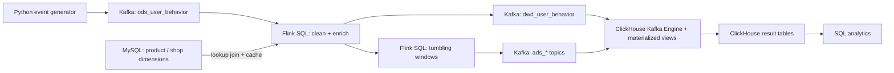

# Real-time E-commerce Analytics Pipeline

A streaming data warehouse that turns e-commerce clickstream events (view, add-to-cart, order, payment) into live business metrics: traffic, conversion funnel, revenue and best-selling products, refreshed every minute.

Built with **Kafka**, **Flink SQL**, **ClickHouse** and **MySQL**, and fully containerised with **Docker Compose**.

## Highlights

- **End-to-end streaming pipeline**: Kafka → Flink SQL (cleaning, dimension enrichment, event-time windows) → Kafka → ClickHouse.
- **5× throughput improvement** (≈478 → 2,400+ events/s) after profiling and removing two bottlenecks.
- **16 ms median latency** at 2,000 events/s, with zero data loss across 1.2M+ benchmark events.
- **Idempotent storage**: ClickHouse tables deduplicate replayed events by `event_id`.
- **One-command demo** with automated end-to-end validation.

## Architecture



1. A Python generator produces user behaviour events and writes them to Kafka.
2. Flink SQL reads the raw events, filters bad records, converts event time and enriches each event with product and shop data from MySQL.
3. The same Flink job computes 1-minute traffic/conversion metrics and 5-minute product sales rankings using event-time tumbling windows (5-second watermark).
4. All Flink outputs go back to Kafka. ClickHouse consumes them directly through Kafka Engine tables and materialized views, writing in batches.

## Tech stack

| Component | Version | Role |
| --- | --- | --- |
| Kafka (Confluent) | 7.6.1 | Event ingestion and decoupling between stages |
| Flink | 1.18 | Stream processing with Flink SQL |
| MySQL | 8.0 | Dimension tables (products, shops, regions) |
| ClickHouse | 24.3 | Analytical storage for detail and metric tables |
| Python | 3.x | Event generator and benchmark tool |
| Docker Compose | – | Local orchestration of all 6 services |

## Data layers

| Layer | Purpose | Implementation |
| --- | --- | --- |
| ODS | Raw events, kept as received | Kafka topic `ods_user_behavior` |
| DWD | Cleaned events enriched with dimensions | Kafka topic and ClickHouse table `dwd_user_behavior` |
| DWS | Windowed aggregation | Flink SQL tumbling-window logic (not materialized separately) |
| ADS | Query-ready metrics | ClickHouse tables `ads_realtime_overview`, `ads_product_rank` |

## Metrics produced

| Table | Window | Metrics |
| --- | --- | --- |
| `ads_realtime_overview` | 1 minute | PV, UV, add-to-cart users, ordering users, paying users, revenue |
| `ads_product_rank` | 5 minutes | Payment count and revenue per product |

## Performance

Benchmarked with [`scripts/benchmark_pipeline.py`](scripts/benchmark_pipeline.py) on the Kafka → Flink SQL → Kafka (DWD) path.

**Test environment:** laptop with Intel i7-9750H; Docker limited to 12 cores / 7.75 GB RAM; single Kafka partition; Flink parallelism 1.

### Bottlenecks found

1. **Uncached dimension lookups.** Every event triggered a synchronous MySQL query per dimension table. Three separate Flink jobs each re-read Kafka and repeated the lookups, so each event caused 6 MySQL queries (≈1.37M queries for 228K events).
2. **Row-by-row ClickHouse inserts.** The original Python loader sent one HTTP `INSERT` per message, reaching only ~50 rows/s.

### Optimizations

1. Enabled Flink lookup caching (`lookup.cache = PARTIAL`, 10-minute expiry). Trade-off: dimension changes can take up to 10 minutes to appear.
2. Merged the three `INSERT` jobs into a single `EXECUTE STATEMENT SET`, so the Kafka read and the dimension joins are shared.
3. Replaced the Python loader with ClickHouse Kafka Engine tables and materialized views for batch ingestion, and switched the DWD table to `ReplacingMergeTree` keyed on `event_id`.

### Results

| Metric | Before | After |
| --- | --- | --- |
| Max pipeline throughput | ≈478 events/s | ≈2,400–3,800 events/s (4 runs × 200K events) |
| MySQL lookups | 6 per event | 1 in total for 150K events |
| Sustained 1,000 events/s | Fell behind: ~70% delivered within 30 s, lag over 25 s | 100% delivered, p50 ≈15 ms, p99 ≈45–370 ms |
| Sustained 2,000 events/s | Not tested (above capacity) | 100% delivered, p50 ≈16 ms, p99 ≈47 ms |
| ClickHouse ingestion | ≈50 rows/s | Kept pace with Flink; 1.28M rows, matching the Kafka count with no duplicates |

Latency is measured from writing to `ods_user_behavior` to the event being readable from `dwd_user_behavior`. It does not include ClickHouse ingestion.

Run the benchmarks yourself:

```bash
# Fixed rate; reports latency percentiles
python3 scripts/benchmark_pipeline.py latency --rate 1000 --duration 30
# Parallel producers as fast as possible; reports max throughput
python3 scripts/benchmark_pipeline.py throughput --count 200000 --producers 4
```

## Design choices

- **Kafka between every stage.** Producers, Flink and ClickHouse are decoupled, and any stage can be replayed from Kafka offsets.
- **Flink SQL instead of the DataStream API.** The cleaning, joins and windows are all expressible in SQL, which keeps the logic short and readable.
- **Lookup join with an in-process cache instead of Redis.** The dimension tables are small, so caching inside the Flink TaskManager avoids a network round trip per event. An external cache only pays off when dimensions outgrow memory or must be shared across services.
- **ClickHouse Kafka Engine instead of a custom loader.** It batches inserts natively, which suits ClickHouse's MergeTree storage much better than single-row writes.

## Project structure

```text
realtime_dw_project/
  docker-compose.yml
  requirements.txt
  flink-sql/
    01_create_source_tables.sql
    02_create_dwd_tables.sql
    03_create_dws_ads_tables.sql
    04_submit_jobs.sql
    05_queries.sql
  scripts/
    run_demo.sh
    validate_pipeline.sh
    download_connectors.sh
    create_kafka_topics.sh
    create_mysql_dim.sql
    create_clickhouse_tables.sql
    run_flink_sql.sh
    generate_mock_events.py
    wait_for_clickhouse.sh
    verify_result.sh
    verify_clickhouse.sql
    benchmark_pipeline.py
  docs/
    architecture.md
```

| File | Purpose |
| --- | --- |
| `docker-compose.yml` | Defines the Kafka, ZooKeeper, MySQL, ClickHouse and Flink services |
| `requirements.txt` | Python dependencies |
| `flink-sql/01_create_source_tables.sql` | Kafka source table and MySQL dimension tables (with lookup cache) |
| `flink-sql/02_create_dwd_tables.sql` | DWD view (cleaning and enrichment) and DWD Kafka sink |
| `flink-sql/03_create_dws_ads_tables.sql` | ADS Kafka sink tables |
| `flink-sql/04_submit_jobs.sql` | Submits all three `INSERT`s as one Flink job via `STATEMENT SET` |
| `flink-sql/05_queries.sql` | Example ClickHouse queries |
| `scripts/run_demo.sh` | One-command demo: rebuilds the environment, runs the pipeline, validates results |
| `scripts/validate_pipeline.sh` | Same flow as the demo, with English log messages |
| `scripts/download_connectors.sh` | Downloads the Flink Kafka, JDBC and MySQL connector jars |
| `scripts/create_kafka_topics.sh` | Creates the four Kafka topics |
| `scripts/create_mysql_dim.sql` | Creates and seeds the MySQL dimension tables |
| `scripts/create_clickhouse_tables.sql` | Creates ClickHouse result tables, Kafka Engine tables and materialized views |
| `scripts/run_flink_sql.sh` | Submits the Flink SQL files through the SQL client |
| `scripts/generate_mock_events.py` | Generates user behaviour events into Kafka |
| `scripts/wait_for_clickhouse.sh` | Waits until ClickHouse has consumed the Flink output |
| `scripts/verify_result.sh` | Checks that the DWD and ADS tables contain data |
| `scripts/benchmark_pipeline.py` | Latency and throughput benchmark |
| `docs/architecture.md` | Architecture, data layers, table and metric definitions |

## Quick start

**Prerequisites:** Docker Desktop, Python 3, at least 8 GB RAM and 10 GB of free disk space. The first run needs internet access to pull Docker images and connector jars.

```bash
cd realtime_dw_project
bash scripts/run_demo.sh
```

The script installs the Python dependencies, downloads the connectors, starts all containers, creates tables and topics, submits the Flink job, generates 220 test events, waits for ClickHouse and validates the results. A successful run ends with output like:

```text
verify passed: dwd_rows=220, overview_rows=1, rank_rows=5
```

The exact `rank_rows` value varies, because events are randomly generated.

> **Warning:** `run_demo.sh` runs `docker compose down -v`, which deletes this project's containers and volumes to start from a clean state.

Flink Web UI: <http://localhost:8081>

## Step-by-step run

Use these steps to see what each component does.

**1. Download the Flink connectors and start the services**

```bash
bash scripts/download_connectors.sh
docker compose up -d
docker ps
```

Download the connectors first. If the jar files are missing when the containers start, Docker creates empty directories in their place and Flink fails to load the connectors.

| Container | Role |
| --- | --- |
| `rtdw_zookeeper` | Kafka coordination |
| `rtdw_kafka` | Message broker |
| `rtdw_mysql` | Dimension database |
| `rtdw_clickhouse` | Analytical database |
| `rtdw_flink_jobmanager` | Flink JobManager |
| `rtdw_flink_taskmanager` | Flink TaskManager |

**2. Load the MySQL dimension tables**

```bash
docker exec -i rtdw_mysql mysql -uroot -proot ecommerce < scripts/create_mysql_dim.sql
```

**3. Create the Kafka topics**

```bash
bash scripts/create_kafka_topics.sh
```

This creates `ods_user_behavior`, `dwd_user_behavior`, `ads_realtime_overview` and `ads_product_rank`. The source topic must exist before the Flink job starts, otherwise the Kafka metadata lookup can fail.

**4. Create the ClickHouse tables**

```bash
docker exec -i rtdw_clickhouse clickhouse-client --password clickhouse --multiquery < scripts/create_clickhouse_tables.sql
```

**5. Install the Python dependencies**

```bash
python3 -m pip install -r requirements.txt
```

**6. Submit the Flink job**

```bash
bash scripts/run_flink_sql.sh
docker exec rtdw_flink_jobmanager /opt/flink/bin/flink list
```

One job is submitted. It produces the DWD detail stream, the real-time overview and the product ranking together.

**7. Generate events**

```bash
python3 scripts/generate_mock_events.py
```

The terminal prints each event as it is sent to Kafka.

**8. Wait for ClickHouse ingestion**

ClickHouse consumes the Flink output topics automatically, so no loader process is needed:

```bash
bash scripts/wait_for_clickhouse.sh 200 90
```

**9. Query the results**

```sql
SELECT *
FROM ads_realtime_overview
ORDER BY window_start DESC
LIMIT 20;

SELECT window_start, window_end, product_name, category_name, pay_count, pay_amount
FROM ads_product_rank
ORDER BY window_start DESC, pay_amount DESC
LIMIT 20;
```

Use `FINAL` to read the deduplicated detail table, for example `SELECT count() FROM dwd_user_behavior FINAL`.

## Event schema

| Field | Description |
| --- | --- |
| `event_id` | Unique event ID |
| `user_id` | User ID |
| `product_id` | Product ID |
| `shop_id` | Shop ID |
| `event_type` | `view`, `cart`, `order` or `pay` |
| `channel` | Traffic channel (`app`, `h5`, `wechat`, `search`, `ad`) |
| `amount` | Order or payment amount |
| `event_time` | Event timestamp |

## Troubleshooting

**Ports in use.** The project uses `9092` (Kafka), `3308` (MySQL, mapped to 3306 inside the container), `8123` (ClickHouse HTTP), `9000` (ClickHouse native) and `8081` (Flink UI). Stop any conflicting service, or change the port mappings in `docker-compose.yml`.

**Python cannot reach Kafka.** Check that `rtdw_kafka` is running. From the host, use `localhost:9092`. From inside a container, use `kafka:29092`.

**Flink cannot find a connector.** Stop the containers, delete any directories named `*.jar` inside `flink-lib/`, run `bash scripts/download_connectors.sh`, then start the containers again.

**ClickHouse has no rows.** Check each stage in order:

1. The event generator is sending data.
2. The Kafka topics are receiving messages.
3. The Flink job is `RUNNING`.
4. `SHOW TABLES` in ClickHouse lists the `kafka_*` and `mv_*` tables.

## Stopping

```bash
docker compose down
```

Add `-v` only if you also want to delete the data volumes.

## Limitations and next steps

- **No Flink checkpointing yet**, so end-to-end delivery is at-least-once. ClickHouse deduplicates DWD rows by `event_id`.
- **Dimension changes can take up to 10 minutes to appear** because of the lookup cache. Flink CDC on the MySQL binlog would make them near real time.
- **Single partition, parallelism 1.** Throughput should scale with more Kafka partitions and Flink parallelism; this has not been benchmarked yet.
- **Demo credentials** (`root/root`, `clickhouse`) are hard-coded for local use only.
- **Planned:** a Grafana dashboard, a region dimension and user-profile metrics.
