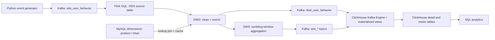

# Architecture

This document describes how data flows through the real-time e-commerce analytics pipeline, how the warehouse layers are organised, and how each table and metric is defined. For setup instructions and benchmark results, see the [README](../README.md).

## 1. Goals

The project builds a complete real-time data path rather than demonstrating one component in isolation. It connects event ingestion, stream processing, dimension enrichment, metric storage and querying, and organises them into data warehouse layers.

It shows how to:

- Ingest a continuous event stream into Kafka.
- Process that stream continuously with Flink SQL.
- Enrich events with business dimensions stored in MySQL.
- Organise data into ODS, DWD, DWS and ADS layers.
- Load results into ClickHouse and query them with SQL.

## 2. Overview



All Flink logic runs as **a single job**. The DWD, overview and ranking outputs are submitted together with `EXECUTE STATEMENT SET`, so the Kafka read and the dimension joins happen once per event and are shared by all three outputs.

## 3. Data flow

### 3.1 Event generation

`scripts/generate_mock_events.py` continuously generates user behaviour events. Each event records one action taken by one user at one moment: viewing a product, adding it to the cart, placing an order or paying.

Example event:

```json
{
  "event_id": "6b6f2e6b-8d9b-4a6a-98a8-f2f6a3f6b001",
  "user_id": 10086,
  "product_id": 1001,
  "shop_id": 1,
  "event_type": "pay",
  "channel": "app",
  "amount": 199.00,
  "event_time": "2026-06-29 20:30:00"
}
```

### 3.2 Ingestion

The Kafka topic `ods_user_behavior` receives the raw JSON events. Kafka buffers the stream and decouples the producer from the consumer:

- The generator only writes to Kafka.
- Flink only reads from Kafka.
- Neither depends on the other being available, and Flink can replay the stream from any offset.

### 3.3 Cleaning

Flink SQL parses the JSON into the ODS source table. Malformed messages are skipped (`json.ignore-parse-errors`). The DWD view then:

- Drops events with a missing `event_id` or `user_id`.
- Keeps only valid event types: `view`, `cart`, `order` and `pay`.
- Converts `event_time` into an event-time attribute, with a 5-second watermark for out-of-order events.
- Joins the product and shop dimensions.

### 3.4 Dimension enrichment

Raw events carry only IDs such as `product_id` and `shop_id`, which are not useful for analysis on their own. Flink enriches each event with business attributes from MySQL through **lookup joins** (`FOR SYSTEM_TIME AS OF proc_time`).

Lookups use a partial in-memory cache (`lookup.cache = PARTIAL`, up to 10,000 rows, 10-minute expiry). This removes almost all MySQL queries. The trade-off is that a change to a dimension row can take up to 10 minutes to appear in the output.

| Table | Contents | Joined in Flink |
| --- | --- | --- |
| `dim_product` | Product name, category, price | Yes |
| `dim_shop` | Shop name, region ID | Yes |
| `dim_region` | Province and city | Not yet (planned) |

### 3.5 Metric computation

Flink SQL computes the metrics with event-time tumbling windows:

- **1-minute window:** PV, UV, add-to-cart users, ordering users, paying users and revenue.
- **5-minute window:** payment count and revenue per product.

### 3.6 Loading into ClickHouse

Flink writes every output to a Kafka topic. ClickHouse reads these topics directly through **Kafka Engine tables**, and **materialized views** convert the rows and insert them into the result tables in batches. No separate loader process is needed.

ClickHouse holds two kinds of results:

- **DWD detail**, for tracing every cleaned and enriched event.
- **ADS metrics**, for fast queries on the real-time aggregates.

All result tables use `ReplacingMergeTree`. The DWD table's sorting key includes `event_id`, so events delivered more than once are deduplicated during merges. Query with `FINAL` to get fully deduplicated results.

## 4. Warehouse layers

| Layer | Purpose | Implementation |
| --- | --- | --- |
| ODS | Land raw data with minimal changes | Kafka topic `ods_user_behavior` |
| DWD | Clean the detail data and add business dimensions | Kafka topic and ClickHouse table `dwd_user_behavior` |
| DWS | Aggregate by subject and time window | Flink SQL tumbling-window logic |
| ADS | Serve query-ready results | ClickHouse tables `ads_realtime_overview`, `ads_product_rank` |

### 4.1 ODS

The ODS layer keeps the events as received: event ID, user ID, product ID, shop ID, event type, channel, amount and event time.

### 4.2 DWD

The DWD layer answers two questions:

1. Is the data clean?
2. Is it complete?

It replaces bare IDs with readable attributes such as product name, category name and shop name.

### 4.3 DWS

The DWS layer aggregates data by business subject. In this project it exists as Flink windowing logic and is not stored as separate tables. It covers:

- Traffic and transactions per time window.
- Payment count and revenue per product.

Channel-level conversion is currently computed at query time in ClickHouse from the DWD table (see `flink-sql/05_queries.sql`).

### 4.4 ADS

The ADS layer is the serving layer. It hides how the detail data was processed and exposes results that reports, APIs or dashboards can use directly.

## 5. Table design

### 5.1 MySQL dimension tables

`dim_product`

| Column | Description |
| --- | --- |
| `product_id` | Product ID (primary key) |
| `product_name` | Product name |
| `category_id` | Category ID |
| `category_name` | Category name |
| `price` | List price |

`dim_shop`

| Column | Description |
| --- | --- |
| `shop_id` | Shop ID (primary key) |
| `shop_name` | Shop name |
| `region_id` | Region ID |

`dim_region`

| Column | Description |
| --- | --- |
| `region_id` | Region ID (primary key) |
| `province` | Province |
| `city` | City |

### 5.2 ClickHouse detail table

`dwd_user_behavior` stores the cleaned and enriched events. Engine: `ReplacingMergeTree`, sorted by `(event_ts, event_type, product_id, event_id)`.

| Column | Description |
| --- | --- |
| `event_id` | Event ID |
| `user_id` | User ID |
| `product_id` | Product ID |
| `product_name` | Product name |
| `category_id` | Category ID |
| `category_name` | Category name |
| `shop_id` | Shop ID |
| `shop_name` | Shop name |
| `event_type` | Event type |
| `channel` | Traffic channel |
| `amount` | Amount |
| `event_ts` | Event time |

### 5.3 ClickHouse metric tables

`ads_realtime_overview`: one row per 1-minute window, sorted by `(window_start, window_end)`.

| Column | Description |
| --- | --- |
| `window_start` | Window start |
| `window_end` | Window end |
| `pv` | Total events in the window |
| `uv` | Distinct users |
| `cart_users` | Distinct users who added to cart |
| `order_users` | Distinct users who placed an order |
| `pay_users` | Distinct users who paid |
| `pay_amount` | Total payment amount |

`ads_product_rank`: one row per product per 5-minute window, sorted by `(window_start, window_end, product_id)`.

| Column | Description |
| --- | --- |
| `window_start` | Window start |
| `window_end` | Window end |
| `product_id` | Product ID |
| `product_name` | Product name |
| `category_name` | Category name |
| `pay_count` | Number of payments |
| `pay_amount` | Total payment amount |

## 6. Metric definitions

| Metric | Definition |
| --- | --- |
| PV | Count of all valid events in the window (all event types, not only views) |
| UV | Count of distinct `user_id` in the window |
| Add-to-cart users | Distinct users with `event_type = 'cart'` |
| Ordering users | Distinct users with `event_type = 'order'` |
| Paying users | Distinct users with `event_type = 'pay'` |
| Revenue | Sum of `amount` over payment events |
| Product ranking | Payment count and revenue per product, ordered by revenue at query time |

## 7. Future work

- **Region dimension:** join `dim_region` to report sales by province and city.
- **User dimension:** add a user table for new-vs-returning, gender and age-group metrics.
- **Flink CDC:** stream MySQL binlog changes into Flink so dimension updates appear within seconds instead of up to 10 minutes.
- **Checkpointing:** enable Flink checkpoints for fault-tolerant, exactly-once processing.
- **Scaling:** add Kafka partitions and raise Flink parallelism, then benchmark how throughput scales.
- **Visualisation:** connect Grafana or Superset for a live dashboard.
- **Lakehouse:** extend storage with Doris, Paimon or Hudi.
